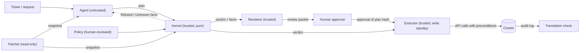

# 02 - Architecture

## Components

| Component | Trust | Does | Never does |
| --- | --- | --- | --- |
| Agent | Untrusted | Reads the ticket and the snapshot; writes a plan; repairs it from Refuted facts | Hold cluster credentials; supply the snapshot the kernel checks against |
| Fetcher | Trusted, read-only identity | Reads the cluster and writes a snapshot in the [snapshot format](../spec/02-snapshot-and-model.md) | Write to the cluster |
| Kernel | Trusted; the core of the TCB | `Check(snapshot, plan, policy) -> verdict`, a pure function ([spec](../spec/README.md)) | I/O, network, clock, randomness, LLM calls, third-party imports |
| Renderer | Trusted | Turns the verdict's facts into a review packet by fixed templates ([spec](../spec/06-review-packet.md)) | Add, drop or reword a fact |
| Policy | Data, human-reviewed | Lists managed scope, protected and critical objects, limits | |
| Executor | Trusted, write identity | Runs a Proved plan step by step with live precondition checks ([contract](areas/c-cluster.md)) | Run a plan whose hashes don't match a Proved verdict and, where required, an approval |
| Translation check | Trusted | Compares the API audit log with the calls the plan should produce | |

## Trust boundaries

1. **Agent → kernel.** The plan is untrusted input. The kernel parses it strictly (unknown fields, operations and kinds are rejected) and believes nothing in it except as a claim to check. Free-text fields (`rationale`, `ticket`) are passed to the packet only in a section labelled as unchecked.
2. **Cluster → kernel.** The snapshot comes from the fetcher, never from the agent. The plan names the snapshot's SHA-256; the kernel checks it.
3. **Kernel → human.** The human sees only rendered facts. The verdict binds the plan, snapshot and policy hashes and the kernel version.
4. **Human → executor.** The approval names the plan hash. The executor checks the verdict, the approval and the hashes before the first step.
5. **Snapshot → live cluster.** Time passes between the check and the run. The executor re-checks each step's preconditions against live state and writes with `resourceVersion` preconditions, so drift stops the run.

## Trusted computing base

What you must trust for a Proved verdict to mean "this plan keeps the rules":

| Part | Why it's trusted | How it's made reviewable |
| --- | --- | --- |
| Kernel code | It computes the verdict | Size budget, standard library only, full branch coverage, mutation testing ([K area](areas/k-kernel.md)) |
| The model of each operation | The kernel's "axioms" | One semantics table per operation; model-fidelity tests on kind ([C area](areas/c-cluster.md)) |
| Policy | Defines the rules' parameters | Short, versioned, human-reviewed; its hash is in the verdict |
| Fetcher | Supplies the state | Read-only identity; tested against known cluster states |
| Renderer | What the human reads | Golden tests; every fact renders, every sentence comes from a fact ([R area](areas/r-review-packet.md)) |
| Executor | Turns the plan into effects | Fixed compile function; live preconditions; translation check against the audit log |

Not trusted: the agent, the model behind it, the plan's free text, and any server-side dry run (used only as an extra check that can add Unknown, never remove it).

## Data flow for one change

1. The fetcher writes `snapshot.json` (and its SHA-256).
2. The agent reads the ticket and the snapshot and writes `plan.yaml`, naming the snapshot hash.
3. `planproof check --snapshot snapshot.json --plan plan.yaml --policy policy.yaml` prints the verdict JSON and exits 0, 1 or 2 for Proved, Refuted or Unknown; `planproof render` prints the packet ([T area](areas/t-cli.md)).
4. On Refuted or Unknown, the agent may revise and resubmit. The facts tell it which step and rule failed.
5. On Proved, if the policy requires approval, a human approves the plan hash after reading the packet.
6. The executor re-fetches, checks drift, and runs the steps with their runtime guards.
7. After the run, the translation check compares the audit log with `compile(plan)`.

## Environments

| Environment | Use |
| --- | --- |
| Unit | Kernel and renderer tests on snapshot files; no cluster |
| kind (WSL2) | Fetcher, executor and model-fidelity tests on a 4-worker cluster |
| CI | Unit tests, size and dependency budgets, template linting on every PR; kind tests on main |

## Repository layout (planned)

| Path | Purpose |
| --- | --- |
| `kernel/` | The kernel: types, parser, model, rules, verdict. Standard library only |
| `render/` | The review packet renderer, its templates and word list |
| `internal/testcases/` | The table of plans the kernel and renderer tests share |
| `cmd/planproof/` | CLI: `check`, `render`, `hash` |
| `internal/yamljson/` | Strict YAML-to-JSON conversion for plans and policies, outside the kernel |
| `fetch/`, `cmd/planproof-fetch/` | Fetcher (client-go), a separate command with its own read-only identity |
| `executor/`, `cmd/planproof-exec/` | Executor: admission (re-runs the kernel), compile, drift check, live assertions, eviction-only drains |
| `cluster/`, `deploy/rbac/`, `test/kind/` | The kind lab cluster, the components' RBAC, and the tests that need the cluster |
| `docs/prd/`, `docs/spec/` | This PRD; the normative spec |
| `examples/` | Worked examples with snapshot, policy, plans and expected packets |
| `tests/fidelity/` | Model-fidelity tests on kind |
