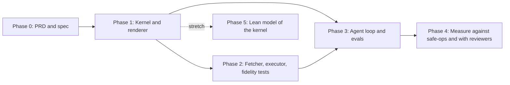

# 04 - Roadmap

## Sequencing

| Phase | Scope | Exit criteria |
| --- | --- | --- |
| 0 | This PRD, the [spec](../spec/README.md), the worked example | The example's expected verdicts and packets are written by hand and agree with the spec |
| 1 | Kernel, renderer, CLI (K, R, T areas). **Done** 2026-10-16 | The worked example passes as golden tests; size, dependency and coverage budgets enforced in CI; every rule has an accept and a reject test |
| 2 | Fetcher, executor, model-fidelity tests on kind (C area). **Done** 2026-10-16 | Each operation's predicted state matches kind; the executor stops on drift and on a wait timeout; translation check passes |
| 3 | Agent loop and evals (E area). **Done** 2026-10-17 | A model writes plans for the seeded tasks and repairs them from Refuted facts; Proved / Refuted / Unknown rates reported |
| 4 | Measurement. **Done** 2026-10-17 | Seeded bad plans through both planproof and the `safe-ops` gate; AI reviewers, packet vs raw plan (the study with people dropped); results published |
| 5 | Stretch: Lean 4 model of the semantics, a soundness proof for the checker, and differential tests between the Go kernel and the Lean model | Proof checks in CI; differential tests run on every PR |

## Milestones

### Phase 0
1. PRD (this folder).
2. Spec: plan, snapshot and model, operations, rules and policy, verdict, review packet, glossary.
3. Worked example: [examples/drain-two-nodes](../../examples/drain-two-nodes/): one Proved plan and two Refuted plans, with expected packets.

### Phase 1
1. **Done.** Go module, CI: build, vet, test, size budget, import check (`make ci`).
2. **Done.** Strict parsing and hashing for all three inputs; fuzz target (`TestInputRejected`, `FuzzCheck`).
3. **Done.** The model and the seven operations; the rules; the verdict (`TestOperations`, `TestRules`, `TestExamples`).
4. **Done.** Renderer, word list, template linter; golden packets for the examples (`go test ./render`).
5. **Done.** CLI (`cmd/planproof`, strict YAML conversion in `internal/yamljson`); `make examples` runs it end to end; kernel coverage enforced at 95% (`make cover`).

### Phase 2
1. **Done.** Fetcher, tested against fixtures applied to kind (`make kind-test`).
2. **Done.** Executor, with runtime guards and an RBAC test (`cmd/planproof-exec`; `make kind-test`).
3. **Done.** Model-fidelity tests: each operation and the example plans run on kind, observed states compared with predictions ([results/kind-test.txt](../../results/kind-test.txt)).
4. **Done.** Translation check against the API audit log (`executor.CheckTranslation`; audit logging on kind via `scripts/enable-audit.sh`).

### Phase 3
1. **Done.** Seeded task set ([evals/tasks.yaml](../../evals/tasks.yaml), 13 tasks, each proved solvable or not).

2. **Done.** Agent loop (`agent/`, `cmd/planproof-eval`) with the scripted model, the local model and Claude Opus, Sonnet and Haiku 5.5 ([results/agent-summary.md](../../results/agent-summary.md), write-up in [results/agent-trials.md](../../results/agent-trials.md)).
3. **Done.** Seeded bad plans, including intent-versus-effect mismatches ([evals/seeded.yaml](../../evals/seeded.yaml), [results/seeded.md](../../results/seeded.md)).

### Phase 4
Design in [areas/e-agent-and-evals.md](areas/e-agent-and-evals.md#phase-4-design-2026-10-17).
1. Head-to-head with the `safe-ops-agent-k8s` OPA gate, both directions, with good plans for false alarms (E-20).
2. Results generated, with a CI check (E-23).
3. Reviewer study with AI reviewers (E-24). The study with people (E-22) is dropped: a personal project.
4. Prior art (E-25) and the blog post (E-26).

## Open questions

| Question | Options | Leaning |
| --- | --- | --- |
| Plan input format | JSON only; YAML converted in the CLI | **Decided**: JSON in the kernel; the CLI accepts YAML through a strict converter (T-03) |
| Where do rolled-out pods land? | Model placement; worst case over candidate nodes | Worst case for budgets, first-fit for capacity (spec 02) |
| Should the kernel propose repairs? | No, facts only; or suggested fixes | Facts only; repair is the agent's job |
| Second platform after Kubernetes | Terraform plans; none | Decide after phase 4 |
